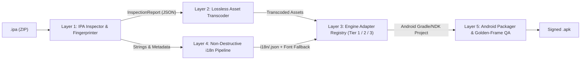

# PortBridge — Especificação Técnica e Arquitetura Modular (`.ipa` → `.apk`)

Este documento define a arquitetura de referência em **5 camadas** para o projeto **PortBridge**, projetada para portar aplicativos e jogos iOS (do iPhone OS 1 ao iOS 27) para Android (`.apk`) com foco em fidelidade determinística, engenharia modular por motor e tradução (i18n) não-destrutiva.

O catálogo de assinaturas binárias utilizado pela Camada 1 encontra-se em [`ENGINE_SIGNATURES.json`](./ENGINE_SIGNATURES.json).

---

## 1. Contratos Arquiteturais Invioláveis

1. **Separação Estrita de Responsabilidades (5 Camadas):** nenhum adaptador de motor pode misturar parsing de ZIP/Mach-O, decodificação de CgBI/PVRTC/CAF, tradução de strings ou invocação direta de Gradle. Todo dado flui por artefatos intermediários tipados (`InspectionReport` → `TranscodedBundle` → `PortedProject` → `TranslationPack` → `SignedApk`).
2. **Disciplina de Testes em Parsers Binários:** nenhuma alteração em parser binário (Mach-O, `CgBI`, `Assets.car`, `Application.cci`, `game.ios`, `.pck`, `.hbc`, `global-metadata.dat`) é considerada concluída sem teste automatizado validando cabeçalhos, offsets, endianness e integridade da saída (round-trip ou golden hash).
3. **Tradução Estritamente Não-Destrutiva:** é proibido sobrescrever strings *in-place* em arquivos binários com tamanho fixo. Toda tradução deve gerar um dicionário externo indexado (`i18n/<locale>.json`) injetado em runtime — ou, quando estritamente exigido pelo formato alvo, reconstruir integralmente as tabelas de strings e offsets com validação de round-trip.
4. **Barreira Obrigatória de FairPlay DRM:** o pipeline deve verificar `LC_ENCRYPTION_INFO` / `LC_ENCRYPTION_INFO_64` antes de qualquer análise profunda. Se `cryptid != 0`, o PortBridge deve abortar com diagnóstico claro (`ERR_FAIRPLAY_ENCRYPTED`) e nunca tentar processar bytes cifrados do segmento `__TEXT`.

---

## 2. Classificação de Fidelidade em 3 Níveis (Tiers)

O roteador do PortBridge classifica cada `.ipa` conforme a sobrevivência da lógica original no pacote:

| Tier | Classe Arquitetural | Motores Típicos | Estratégia de Reconstrução no Android | Teto de Fidelidade |
| :--- | :--- | :--- | :--- | :--- |
| **Tier 1** | **Data-Driven / Bytecode / Web** | Clickteam Fusion (`Application.cci`), GameMaker VM (`game.ios`), Godot (`.pck`), Solar2D (`resource.car`), Defold, Ren'Py, LÖVE, RPG Maker, Construct, Cordova/Capacitor, React Native (`.jsbundle`/`.hbc`) | Re-targeting ou reimplementação determinística de runtime (NDK C++, Kotlin ou WebView) lendo os dados originais transcodificados. | **98% – 100%** (frame-exact alcançável) |
| **Tier 2** | **AOT Gerenciado com Metadados** | Unity (IL2CPP + `global-metadata.dat` ou Mono AOT), Flutter (`App.framework`), Xamarin/`.NET MAUI`, Adobe AIR AOT, LibGDX (MOE/RoboVM), Lynx/Valdi, Tauri | Extração integral de assets/metadados + estratégia híbrida (re-targeting de assemblies/módulos, lifting ou ponte de ABI AArch64). | **75% – 95%** |
| **Tier 3** | **Mach-O Nativo Puro** | Objective-C/Swift (`UIKit`/`SpriteKit`/`SceneKit`), Unreal Engine (UE3/4/5), GameMaker YYC, Cocos2d-x C++, Marmalade, Haxe (`hxcpp`), KMP, Delphi FMX | Loader Mach-O AArch64 + camada HLE Darwin/UIKit (estilo Wine/touchHLE) ou recompilação estática via LLVM lifting. | **Variável** (100% CPU; limitado por APIs de GPU/OS) |

---

## 3. Pipeline Modular em 5 Camadas



### Layer 1 — IPA Inspector & Universal Engine Fingerprinter

Responsável por abrir o `.ipa`, localizar `Payload/*.app/`, parsear o binário Mach-O principal (e `Frameworks/*.framework`) e aplicar o catálogo `ENGINE_SIGNATURES.json`.

**Passos obrigatórios:**
1. **Unpack Seguro:** validação contra Zip Slip (`../`), leitura de `Info.plist` (convertendo `bplist00` para JSON estruturado) para extrair `CFBundleIdentifier`, `CFBundleExecutable`, `MinimumOSVersion`, orientações e `UIApplicationSceneManifest`.
2. **Mach-O & Fat Binary Parser:**
   - Detectar Fat/Universal (`0xcafebabe` / `0xcafebabf`) e selecionar a slice prioritária (`ARM64` / `ARM64e`, fallback `ARMv7s` → `ARMv7` → `ARMv6`).
   - Inspecionar Load Commands: `LC_ENCRYPTION_INFO(_64)`, `LC_LOAD_DYLIB`, `LC_LOAD_WEAK_DYLIB`, `LC_RPATH`, `LC_DYLD_CHAINED_FIXUPS`, `LC_BUILD_VERSION`.
   - Extrair tabela de símbolos, nomes de classes Objective-C (`__DATA,__objc_classlist`) e seções Swift (`__TEXT,__swift5_types`).
3. **Motor de Scoring (`ENGINE_SIGNATURES.json`):**
   - Avaliar regras em ordem de `priority` crescente usando os pesos definidos (`magic_match: 60`, `required_file: 25`, `framework: 20`, `macho_symbol: 15`).
   - Retornar `InspectionReport` com motor primário, variante/versão exata (ex.: versão `uint32` do `global-metadata.dat`, `GDPC` do Godot, versão do `.hbc` do Hermes, `PAMU` vs `PAME` do `.cci`), nível de confiança, status FairPlay e inventário completo de assets proprietários.

---

### Layer 2 — Lossless Asset Transcoder

Converte formatos exclusivos da Apple para formatos nativamente suportados pela GPU e decoders do Android sem alterar dimensões, pivôs ou transparência.

| Formato iOS | Assinatura | Transformação Exata para Android |
| :--- | :--- | :--- |
| **Apple CgBI PNG** | `89 50 4E 47 ... CgBI` (offset 12) | Remover chunk `CgBI`, reinflar `IDAT` raw deflate (`wbits=-15`), trocar canais `BGRA → RGBA`, desfazer premultiplied alpha (`c = round(c * 255 / a)` quando `a > 0`) sem gerar halos em pixel art, recomprimir com cabeçalho zlib padrão e recalcular CRCs. |
| **Assets.car (CoreUI/BOM)** | `BOMStore` (offset 0) | Extrair entradas do catálogo CoreUI preservando escala (`@1x/@2x/@3x`), sliced 9-patch e paletas de cores. |
| **PVRTC / `.pvr.ccz`** | `PVR\x03`, `PVR!`, `CCZ!`/`CCZp` | Descomprimir CCZ (zlib), decodificar PVRTC 2bpp/4bpp para `RGBA8888` lossless (ou re-encodar em `ASTC`/`ETC2` conforme perfil alvo). |
| **Áudio CAF / IMA4 / ALAC** | `caff` (offset 0) | Transcodificar SFX curtos para `WAV PCM 16-bit` (baixa latência no Android AudioTrack/Oboe) e trilhas longas para `OGG Vorbis` ou `Opus`, preservando loop points. |
| **Binary Plist (`bplist00`)** | `bplist00` (offset 0) | Converter para JSON/XML UTF-8 padronizado. |
| **Shaders (`.metallib` / GLSL ES)** | `MTLB` (offset 0) | Para GLSL ES: normalizar diretivas `precision mediump/highp float`. Para Metal AIR: mapear shaders conhecidos da engine ou acionar transpiler para SPIR-V/GLSL ES 3.0. |

---

### Layer 3 — Engine Adapter Registry

Cada motor vive em um módulo isolado implementando a interface `EngineAdapter`:

```text
interface EngineAdapter {
  id: string
  tier: 1 | 2 | 3
  supports(report: InspectionReport): boolean
  extract(context: PortContext): ExtractedProject
  reconstruct(project: ExtractedProject, i18n?: TranslationPack): AndroidTargetProject
  verify(apkPath: string, replayScript?: string): VerificationResult
}
```

#### Requisitos de Paridade Determinística (Tier 1)
Para atingir fidelidade frame-exact em motores reconstruídos (Clickteam, GameMaker VM, Godot, Solar2D, etc.):
- **Fixed Timestep Independente de Refresh Rate:** travar o passo lógico (ex.: 60 Hz fixos) com acumulador de delta-time para impedir que telas Android de 90 Hz / 120 Hz acelerem física ou quebrem saltos.
- **Ordem Exata de Eventos & Object Scoping:** preservar filtragem de instâncias selecionadas por condição, disparo síncrono de fastloops e ciclo de vida exato de criação/destruição de objetos no fim do tick.
- **Colisão Pixel-Perfect:** manter bitmasks baseadas no canal alpha pós-rotação/escala quando o motor original suportar colisão fina (nunca degradar silenciosamente para AABB).
- **Aritmética Numérica:** respeitar `float32` vs `float64` e semântica de arredondamento (`trunc` vs `floor` vs `round`) da engine original.
- **Apple Services Shim Layer:** prover implementações locais não-bloqueantes para `GameKit` (Game Center), `StoreKit` (IAP mock/local), `iCloud`/`NSUbiquitousKeyValueStore` e `NSUserDefaults` (mapeado em `SharedPreferences` ou arquivo interno persistente).

#### Requisitos para Execução Nativa AArch64 (Tiers 2 e 3)
Quando o adaptador avançar para execução direta de binários Mach-O ARM64 no Android ARM64:
- **Loader Mach-O + Chained Fixups:** mapear segmentos `__TEXT`/`__DATA` respeitando alinhamento de página de **16 KB** (mesmo em kernels Android de 4 KB).
- **Trampolines de ABI Darwin ↔ AAPCS64:** traduzir chamadas variádicas (argumentos na stack no Darwin ARM64 vs registradores `x0–x7` no Linux/Android AAPCS64) e proteger o registrador reservado `x18`.
- **HLE Shims:** redirecionar `libSystem` (XNU/BSD) para Bionic, fornecer runtime Objective-C (`libobjc2`) e shims progressivos de `CoreFoundation`, `OpenAL`, `OpenGLES`/`Metal`.

---

### Layer 4 — Non-Destructive i18n & Translation Pipeline

Projetada para traduzir apps e jogos (ex.: `en → pt-BR`) sem risco de corrupção binária ou quebra de layout.

1. **Extração Multi-Camada:**
   - Padrão iOS: `*.lproj/Localizable.strings`, `InfoPlist.strings`, `.stringsdict`, `.xcstrings`.
   - Específica de Engine: chunks de strings do `Application.cci`, chunk `STRG` do `game.ios`, tabela de literais do `global-metadata.dat`, `.translation`/`.csv` do Godot, `www/data/*.json` do RPG Maker, tabela de strings do `.hbc` (Hermes).
   - Fallback controlado: `__TEXT,__cstring` / `__DATA,__cfstring` apenas quando explicitamente habilitado.
2. **Filtro Semântico Anti-Quebra (Obrigatório):**
   - Descartar automaticamente caminhos de arquivo (`assets/*.png`), extensões, URLs, shaders GLSL/Metal, seletores Objective-C (`initWithFrame:`), chaves `NS*`/`UI*`/`CF*`, identificadores em `snake_case`/`camelCase` internos e nomes de animações/grupos.
3. **Trava de Placeholders (Pré e Pós-Tradução):**
   - Extrair e validar contagem, ordem e tipo de especificadores: `%@`, `%d`, `%s`, `%1$.2f`, `{0}`, `\\n`, tags ricas (`<color=#fff>`, `[b]`, `\c[1]`).
   - Qualquer tradução cuja assinatura de placeholders divergir da original é **rejeitada automaticamente** e mantida no texto fonte com registro em relatório de pendências.
4. **Injeção em Runtime via Dicionário Indexado:**
   - Formato: `assets/i18n/<locale>.json` indexado por chave composta `context_id::sha256(original_text)`.
   - O runtime consulta o dicionário no carregamento/renderização de texto, permitindo strings de comprimento arbitrário e troca dinâmica de idioma sem tocar nos binários originais.
5. **Suporte a Fontes Bitmap & Expansão de Texto (PT-BR):**
   - **Acentuação (`á é í ó ú ã õ ç â ê ô`):** oferecer dois modos configuráveis no runtime:
     1. *Glyph Synthesizer / TTF Fallback (padrão):* sintetiza diacríticos no atlas da bitmap font ou faz fallback por glifo para fonte TrueType vetorial.
     2. *ASCII Fold (opcional):* normaliza acentos apenas se o usuário exigir 100% da bitmap font pixelada original sem síntese.
   - **Auto-Wrap & Auto-Shrink:** quando a largura medida da string traduzida exceder o bounding box original, aplicar quebra de linha segura ou redução proporcional de escala (piso configurável, ex.: `0.78x`).

---

### Layer 5 — Android Packager, Golden-Frame QA & CI

1. **Geração de Projeto Android Limpo:** template Gradle modular (Kotlin + CMake/NDK quando houver core C++), `AndroidManifest.xml` gerado a partir do `Info.plist`, suporte configurável a aspect ratio (`letterbox`, `pillarbox` ou `safe-camera-expand` para telas 20:9), mapeamento de toque/controles virtuais/gamepad e ícones adaptativos extraídos do `.ipa`.
2. **Empacotamento e Validação Estrutural:** `aapt2` → `zipalign -p 4` (e alinhamento de 16 KB para bibliotecas `.so` exigido pelo Android 15+) → `apksigner` (v2/v3) com verificação pós-assinatura.
3. **Golden-Frame Testing (Prova de Fidelidade):**
   - Suporte opcional no runtime para gravação e reprodução determinística de inputs (replay log / TAS).
   - Comparação automatizada por frame de estado interno (coordenadas `(x, y)`, flags, contadores) e métricas visuais (SSIM/PSNR) contra capturas de referência.

---

## 4. Estrutura de Diretórios Recomendada para o PortBridge

```text
PortBridge/
├── ARCHITECTURE.md
├── ENGINE_SIGNATURES.json
├── core/
│   ├── inspector/          # Layer 1: ZIP seguro, Mach-O parser, FairPlay gate, Fingerprinter
│   ├── transcoder/         # Layer 2: CgBI PNG, Assets.car, PVRTC/CCZ, CAF, bplist
│   ├── i18n/               # Layer 4: Extrator multi-camada, filtro semântico, placeholder guard
│   └── packager/           # Layer 5: Gerador Gradle/NDK, zipalign, apksigner
├── adapters/               # Layer 3: Um plugin isolado por motor
│   ├── registry.*
│   ├── clickteam_fusion/
│   ├── gamemaker_vm/
│   ├── godot/
│   ├── solar2d/
│   ├── web_hybrid/         # Cordova, Capacitor, RPG Maker, Construct
│   ├── react_native/
│   ├── unity/
│   └── native_hle/
├── templates/
│   └── android/            # Templates base Gradle / Kotlin / CMake NDK
└── tests/
    ├── unit/               # Testes de parsers binários e validação de placeholders
    ├── fixtures/           # Micro-headers sintéticos versionados no Git (Mach-O, CgBI, FORM, GDPC)
    └── samples/            # (.gitignore) .ipa reais descriptografados (cryptid == 0) para QA local
```

---

## 5. Roadmap de Execução por Fases

- **Fase 0 — Auditoria & Baseline:** mapear o código existente do PortBridge, alinhar linguagem/toolchain principal do projeto e criar testes unitários com headers binários sintéticos em `tests/fixtures/`.
- **Fase 1 — Layer 1 (Inspector + Fingerprinter):** implementar parser Mach-O/Fat, gate de FairPlay (`cryptid == 0`) e motor de detecção guiado por `ENGINE_SIGNATURES.json`.
- **Fase 2 — Layer 2 (Lossless Asset Transcoder):** implementar e testar matematicamente `CgBI → RGBA PNG`, `bplist00 → JSON`, `CAF → WAV/OGG`, `PVRTC/CCZ → RGBA` e extrator `Assets.car`.
- **Fase 3 — Layer 3 (Engine Adapters Tier 1):** migrar/construir os adaptadores prioritários de Tier 1 com contrato `EngineAdapter`, timestep fixo e shims de serviços Apple.
- **Fase 4 — Layer 4 (Non-Destructive i18n):** plugar extrator filtrado, validador de placeholders, injeção via `i18n/<locale>.json` e tratamento de acentos PT-BR em bitmap fonts.
- **Fase 5 — Layer 5 (Packager + CI + Golden-Frame QA):** automatizar build `.apk`, checagens `aapt2`/`zipalign`/`apksigner` e suíte de regressão contínua no GitHub Actions.
